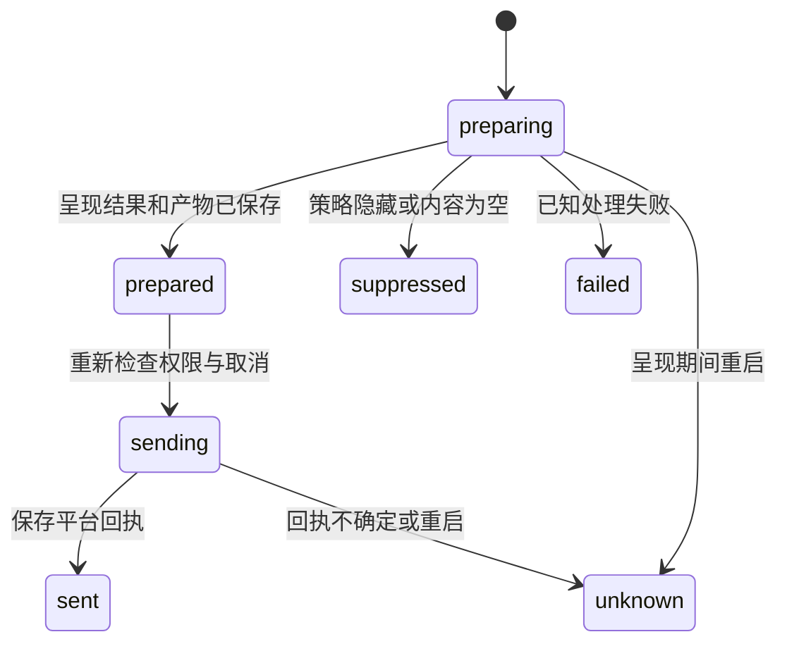

# 共享切入点与持久观察

本页的验收开关和依赖状态描述对应历史阶段；当前部署状态以在线诊断为准。2026-11-12 部署记录已启用，2026-11-13 只读观察确认 enabled:true；本轮源码修复未部署。详见 [审核修复记录](review-remediation-2026-11-12.md)。

第四阶段 C 接入六个核心切入点。插件经 Worker RPC 接收副本并返回声明的结果，核心负责排序、合并、授权、记账和平台发送。插件之间没有共享的可变事件对象。

| 切入点 | 执行方式 | 已接入的位置 |
| --- | --- | --- |
| `context.collect@1` | 有界并行收集，稳定排序、来源去重和总预算 | Pi 每轮的补充上下文；轮内复用 |
| `delivery.visibility@1` | 确定性策略，拒绝即隐藏 | 最终回复、显式发送、插件指令、后台结果 |
| `delivery.text@1` | 按依赖和优先级顺序变换 | 呈现前的文字；只允许写 `/text` |
| `delivery.presentation@1` | 按序选择第一个有效呈现器 | 文字/媒体产物的实际交付形式 |
| `delivery.receipt@1` | 消费持久回执，独立任务处理 | 已确认、未知或按策略隐藏的交付事实 |
| `message.recorded@1` | 消费持久消息事实 | 已启用范围内的 QQ/Mock 用户消息，包括未触发模型的消息 |

控制回复使用核心直达路径，避免插件故障阻挡 `/help`、`/stop` 和错误通知。插件自定义切入点的运行 RPC 已由 [第四阶段 D](plugin-storage.md) 接入；`around` 尚未开放。工具收纳继续使用既有的单一选定策略。

## 输入、权限与顺序

每个 handler 有独立能力 ID `hook:plugin:<实例>/<handler>`，按插件选中范围、原触发身份上限、当前权限和停用项决定是否运行。Hook 不作为 LLM 工具暴露，也不受工具搜索的装载状态控制。成员共用群上下文，触发权限仍分别检查。

当前设置可覆盖 priority、停用项和插件参数；before/after/requires 先于 priority，数字不能反转必需依赖。数据返回时再次校验版本、字段和完整 schema，失效的返回值不会部分提交。没有权限或不匹配 selector 的来源不会取得输入。

文字变换失败默认沿用最后一份有效输入，依赖失败的后续变换也会跳过；声明 `onError: fail` 则停止这一条流程。可见性策略无法完成时停止该次交付。呈现选择的 `null` 表示不接管，首个有效非空选择获选，其后的呈现器不再运行。

收集、策略和文字变换禁止产物写入、直接发送和跨插件操作，只允许获准的读取服务。它们访问 MCP 时要求登记及实际调用前的工具定义都声明 `readOnlyHint: true`；这项附加检查不影响普通授权 MCP 调用。呈现器可以生成产物或调用显式依赖的领域操作。所有 Hook 均不能直接发送群消息。

上下文默认总预算为 `plugins.maxContextChars: 8000`，来源调用有界并发，收集窗口为 3 秒。可选来源超时可省略，必需来源失败会报告。片段带来源和键，不改写 Pi 历史，也不增加主模型请求。片段和启用的工具 schema 仍计入正常输入 token。

## 呈现与交付账本



账本先保存原始请求，再执行呈现。已完成的呈现保存实际文字、产物 ID、使用的 handler 和配置摘要，恢复时复用；不会重新调用 TTS 等服务。原始文字和请求产物与实际呈现分别保存，因此带新音频的回复重复受理时不会因产物列表变化而重发。

呈现期间中断无法确认外部生成结果时，记为 `unknown`，不重新生成或发送。发送中断保留已知平台 ID，同样不自动重发。无效的原始跨群产物在创建账本前拒绝。模型原文、Pi transcript 和任务业务结果保持原有语义，TTS 不把波形数据写回模型历史。

隐藏交付具有自己的账本状态，不伪造已发送回执，不产生空群消息；Agent 可正常结束。`chat_send` 明确返回 `delivered: false, suppressed: true`，避免模型把隐藏误认成发送成功。默认呈现总期限为 15 秒；每个处理器仍受自己的期限和取消信号约束。

## 持久观察和后续动作

消息与待观察事件在宿主数据库同一事务保存。发送开始时记录尚未就绪的观察事件，保存真实回执后才使它可消费；发送中重启则按未知回执恢复。事件包含固定配置引用、原触发权限、群范围和安全的事实输入，凭据留在私有配置归档中。

观察任务复用 Pi durable 的非模型任务机制，按事件/handler 去重。Native 受理提交后再移除宿主 outbox，消除两份存储之间的重复受理窗口。观察动作实际开始前写检查点；中断后将其标为未知，不重跑可能已经完成的外部副作用。

观察器不阻塞发送者。默认全局自动观察额度 64、每插件活动额度 8、每插件 outbox 额度 8；单事件最大 256 KiB、最多 64 个处理器、60 秒受理期限。观察执行默认最多 1 秒，预留前台 Worker 名额。额度不足、过期、失败和未知状态可在「能力资源 → 观察任务与后续动作」查看，活动任务可定向停止。

撤回示例：

```js
export default {
  hooks: {
    async receipt(input, context) {
      if (input.state !== 'sent') {
        return
      }
      await context.host('delivery.recall', {
        messageId: input.messageId,
        delayMs: 180000
      })
    }
  }
}
```

对应 handler 声明 `point: "delivery.receipt@1"`、`mode: "observe"`，并在 handler 和实例的 grants 中授权 `delivery.recall`。触发来源还须拥有独立的 `message_recall` 动作权限；它不作为 LLM 工具装载。

观察器只能安排撤回本次已确认回执对应的逻辑消息，不能选择别的群或别的消息。延迟最长 24 小时，核心保存后续任务，休眠期间释放 Worker；到期再检查权限、实例状态、对话代际和每条平台消息。多分部回执逐条撤回，已知已撤回的部分不重做。

延后动作与观察处理使用独立额度：默认全局 128、每插件 64，实际执行并发 2。群 `/stop` 中断活动插件调用；已经登记的延后动作可在观察页单独停止。切换对话或撤销权限会使旧动作不能继续执行。此协议不承诺外部副作用恰好执行一次：无法确认的操作会保留未知状态。

## 跨插件 operation RPC

调用方配置显式依赖，例如 `dependencies: { "images": "image-backend" }`，在 operation/handler 与实例 grants 中授权 `operation:images/render`，然后调用：

```js
const result = await context.host('operation:images/render', {
  arguments: { prompt: input.prompt },
  phase: 'execute'
})
```

`phase` 也可为 `poll` / `cancel`，由同一 operation 的声明处理。RPC 返回统一的 done/pending/failed/cancelled 结果；长任务句柄及恢复仍由操作/Job 协议负责，不自动重放。

目标插件只接收自己的设置和同一群范围，保留原触发人的授权上限。每一跳都检查调用方依赖授权与目标能力；不能通过转交获得另一成员的权限。依赖撤销会阻止排队中的后续调用。调用链有深度限制，重入或名额耗尽立即拒绝，不持有 Worker 互等。

插件直接发送时若回到自己的处理器，核心拒绝该重入并按该切入点的失败策略处理。独立观察任务清除父调用链，不把已经结束的操作误判为递归。通常业务操作返回结果，随后由宿主统一呈现和发送。

## 验收与剩余工作

验证使用实际 Bun Worker、假 Responses/MCP 和原生 durable 任务，覆盖文字/TTS/撤回组合、原文保留、呈现复用、重启撤回、卡死观察器、普通消息采集、成员权限、循环调用及只读 MCP 定义变化。Web 验证配置、状态查询和定向停止，手机页面无横向溢出。

该阶段验收时插件执行后端关闭。持久数据硬容量上限、大文件发布、统一产物额度、插件自定义 point 运行和真实容器隔离验收已由 [第四阶段 D](plugin-storage.md) 完成。外部连接器扩展、领域插件、Telegram 和知识库迁移继续推进。
